<!-- ============================  HEADER  ============================ -->
<div align="center">


<a href="#">
  
</a>

<br/>


<br/>


</div>

---

## 📖 Overview

**Intelligent IoT Anomaly Detection** is an end-to-end Industrial IoT (IIoT) research platform that detects abnormal machine behaviour from live sensor readings. A **deep autoencoder** learns what "normal" looks like; anything it cannot reconstruct well is flagged as an **anomaly**.

The system goes beyond a single model:

- 🏭 **Federated Learning** — multiple factories collaboratively train one global model **without sharing raw data** (Flower + FedAvg).
- 🔐 **AES-256 encryption** — every sensor payload is encrypted/decrypted in the inference pipeline to simulate secure IIoT transport.
- 🧠 **Explainability** — SHAP highlights which sensor drove a given prediction.
- 📡 **Interactive dashboard** — a Streamlit control room with live predictions, trend charts, history, analytics and model diagnostics.

Built on the **[AI4I 2020 Predictive Maintenance Dataset](https://archive.ics.uci.edu/dataset/601/ai4i+2020+predictive+maintenance+dataset)** (10,000 samples).


## ✨ Key Features

<table>
<tr>
<td width="50%" valign="top">

### 🧠 Deep Autoencoder
Symmetric `5 → 32 → 16 → 8 → 16 → 32 → 5` network trained to reconstruct healthy sensor states. Reconstruction MSE above the **99th-percentile threshold** ⇒ anomaly.

</td>
<td width="50%" valign="top">

### 🏭 Federated Learning
Dataset split across **Factory A / B / C**. Each client trains locally; a Flower server aggregates weights with **FedAvg** over 5 rounds.

</td>
</tr>
<tr>
<td width="50%" valign="top">

### 🔐 AES-256 Data Security
Sensor readings are serialised, encrypted with **AES-256-CBC** (random IV per message), then decrypted before inference.

</td>
<td width="50%" valign="top">

### 📊 Real-time Dashboard
Gauges, live trend charts, machine-health score, prediction history with CSV export, analytics and model-performance graphs.

</td>
</tr>
<tr>
<td width="50%" valign="top">

### 🔎 Explainable AI
`src/explain.py` uses **SHAP KernelExplainer** to rank each sensor's contribution to the anomaly score.

</td>
<td width="50%" valign="top">

### 📝 IEEE-style Evaluation
Accuracy, Precision, Recall, F1, confusion matrix and full classification report on a stratified hold-out set.

</td>
</tr>
</table>

## 🏗️ System Architecture

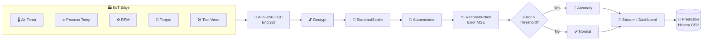

### 🌐 Federated Learning Topology

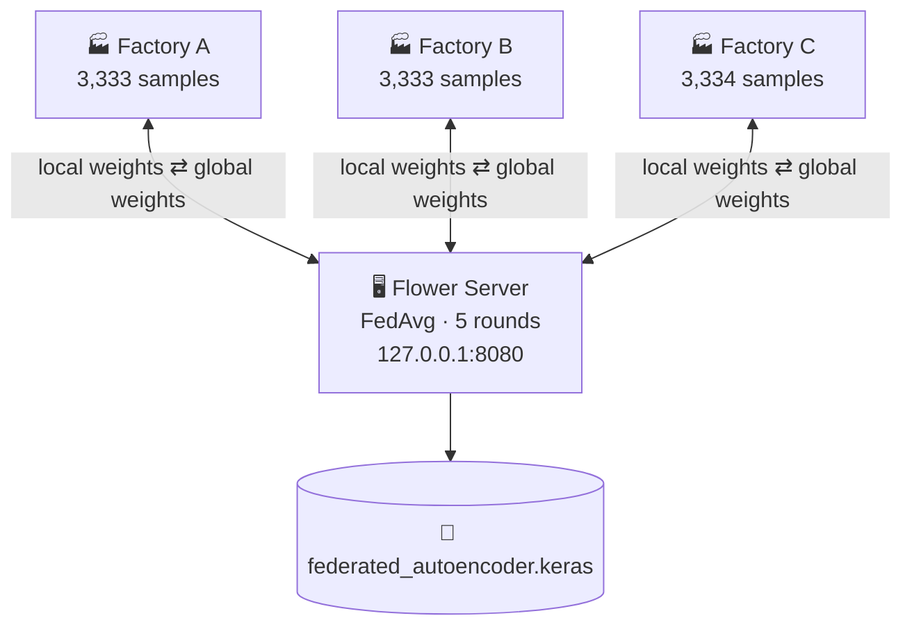

> 🔒 Raw sensor data **never leaves** a factory — only model weights are exchanged.

### 🧬 Autoencoder Design

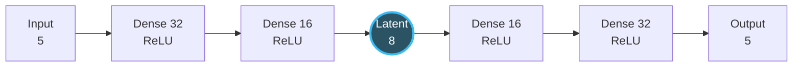

| Setting | Value |
|---|---|
| Loss | Mean Squared Error |
| Optimizer | Adam |
| Batch size | 256 (centralised) · 32 (federated) |
| Anomaly threshold | 99th percentile of reconstruction error |
| Split | 80 / 20 stratified on `Machine failure` |

## 📈 Results

<div align="center">

| Training Loss | Reconstruction Error Histogram |
|:---:|:---:|
| 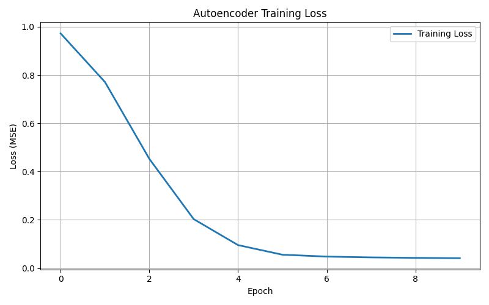 | 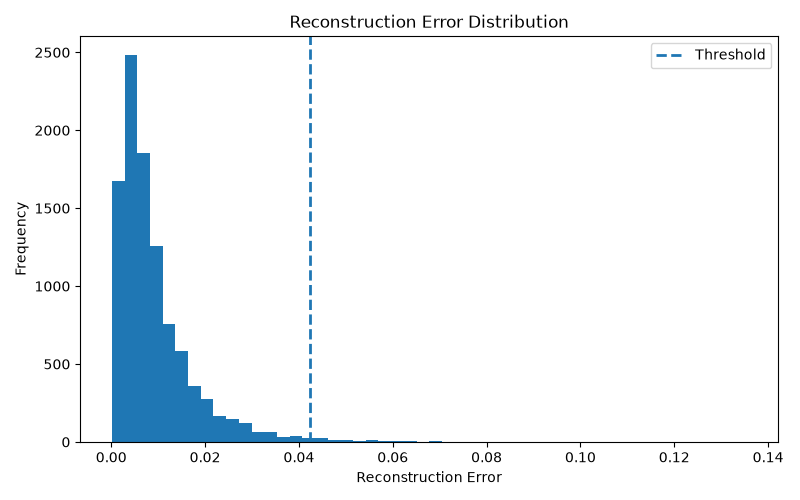 |

| Reconstruction Error over Samples |
|:---:|
| 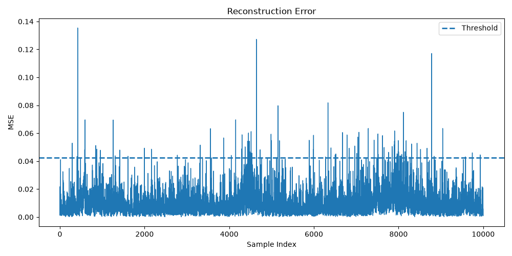 |

</div>

<details>
<summary><b>📂 Feature distributions (click to expand)</b></summary>
<br/>

| Air Temperature | Process Temperature | Rotational Speed |
|:---:|:---:|:---:|
| 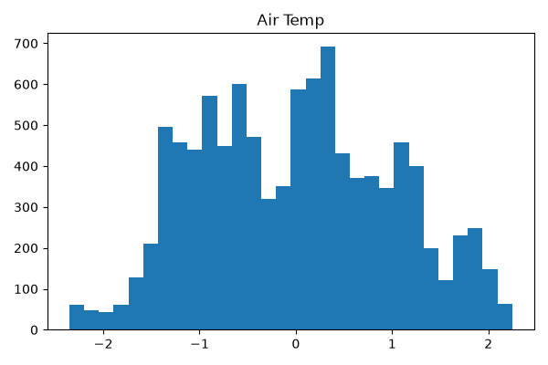 | 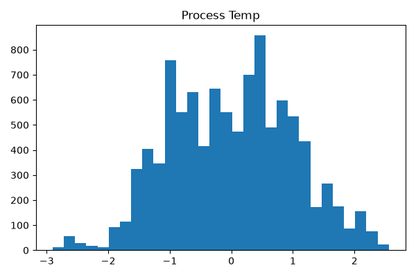 | 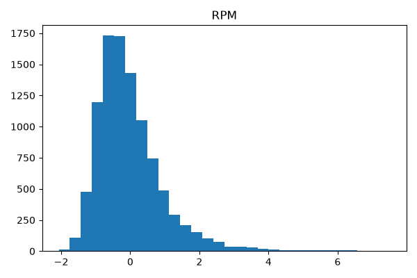 |

| Torque | Tool Wear |
|:---:|:---:|
| 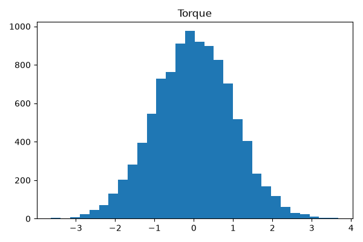 | 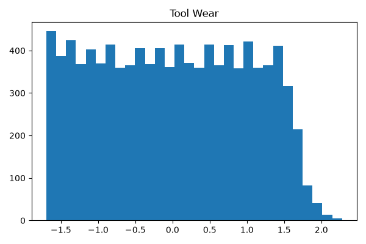 |

</details>

## 📁 Project Structure

```text
intelligent-iot-anomaly-detection-v2/
├── 📂 dashboard/
│   └── app.py                    # Streamlit monitoring dashboard
├── 📂 data/
│   ├── ai4i2020.csv              # AI4I 2020 predictive maintenance dataset
│   └── factory_{A,B,C}.csv       # Federated client partitions
├── 📂 models/
│   ├── autoencoder.keras         # Trained autoencoder
│   ├── scaler.pkl                # Fitted StandardScaler
│   ├── threshold.pkl             # Anomaly threshold
│   └── X_test.pkl / y_test.pkl   # Hold-out evaluation set
├── 📂 results/                   # Training & evaluation plots
├── 📂 src/
│   ├── preprocess.py             # Load, split & scale data
│   ├── train.py / train_ieee.py  # Autoencoder training
│   ├── evaluate.py               # Reconstruction-error evaluation
│   ├── evaluate_ieee.py          # Accuracy / Precision / Recall / F1
│   ├── predict.py                # Encrypted inference pipeline
│   ├── encryption.py             # AES-256-CBC helpers
│   ├── explain.py                # SHAP explainability
│   ├── graphs.py                 # Result plot generation
│   ├── history.py                # Prediction logging
│   ├── split_dataset.py          # Factory A/B/C split
│   └── 📂 federated/
│       ├── server.py             # Flower server (FedAvg)
│       ├── client.py             # Flower factory client
│       ├── strategy.py           # Aggregation strategy
│       ├── model.py              # Shared model definition
│       └── save_global_model.py  # Persist global weights
├── test_model.py                 # Inference smoke test
└── requirements.txt
```

## 🚀 Getting Started

### 1️⃣ Clone & install

```bash
git clone https://github.com/rahulmj2004/intelligent-iot-anomaly-detection-v2.git
cd intelligent-iot-anomaly-detection-v2

python -m venv venv
source venv/bin/activate          # Windows: venv\Scripts\activate

pip install -r requirements.txt
pip install flwr matplotlib shap  # federated learning, plots & XAI extras
```

### 2️⃣ Launch the dashboard

Pre-trained artefacts are included in `models/`, so you can start right away:

```bash
streamlit run dashboard/app.py
```

### 3️⃣ Train & evaluate (optional)

```bash
python src/train_ieee.py        # train autoencoder + compute threshold
python src/evaluate_ieee.py     # accuracy, precision, recall, F1
python src/graphs.py            # regenerate result plots
python test_model.py            # quick inference smoke test
```

### 4️⃣ Run Federated Learning

```bash
python src/split_dataset.py                       # create factory_A/B/C.csv

# Terminal 1 — server
python src/federated/server.py

# Terminals 2, 3, 4 — one client per factory
python src/federated/client.py --factory factory_A
python src/federated/client.py --factory factory_B
python src/federated/client.py --factory factory_C
```

## 🖥️ Dashboard Tour

| Tab | What it shows |
|---|---|
| 🔍 **Live Prediction** | Enter 5 sensor values → anomaly verdict, reconstruction error, risk gauge, encrypted / IV / decrypted payload |
| 📡 **Live Dashboard** | Rolling sensor trends and machine-health gauge |
| 📜 **History** | Every prediction, timestamped, with CSV download |
| 📊 **Analytics** | Normal vs. anomaly breakdown and error statistics |
| 🧠 **Model Performance** | Training loss & reconstruction-error graphs |
| 📂 **Feature Distribution** | Per-sensor distribution plots |

## 📊 Dataset

| Feature | Unit | Description |
|---|---|---|
| Air temperature | K | Ambient air temperature |
| Process temperature | K | Machine process temperature |
| Rotational speed | rpm | Spindle speed |
| Torque | Nm | Applied torque |
| Tool wear | min | Cumulative tool usage |
| **Machine failure** | 0 / 1 | Ground-truth label (used only for evaluation) |

## 🛡️ Security Note

`src/encryption.py` ships with a **hard-coded demo key** for reproducibility. For any real deployment, load the AES key from an environment variable or a secrets manager and never commit it to source control.

## 🗺️ Roadmap

- [x] Deep autoencoder anomaly detector
- [x] AES-256 encrypted inference pipeline
- [x] Federated learning across 3 simulated factories
- [x] Streamlit monitoring dashboard
- [x] SHAP explainability module
- [ ] MQTT ingestion from real IoT devices
- [ ] Secure aggregation & differential privacy for FL
- [ ] Docker deployment

## 🤝 Contributing

Contributions, issues and feature requests are welcome!

1. Fork the repository
2. Create a feature branch: `git checkout -b feature/amazing-feature`
3. Commit your changes: `git commit -m "Add amazing feature"`
4. Push the branch and open a Pull Request

## 👤 Author

<div align="center">

**Rahul M J**

[](https://github.com/rahulmj2004)

⭐ **If you found this project useful, consider giving it a star!** ⭐

</div>


